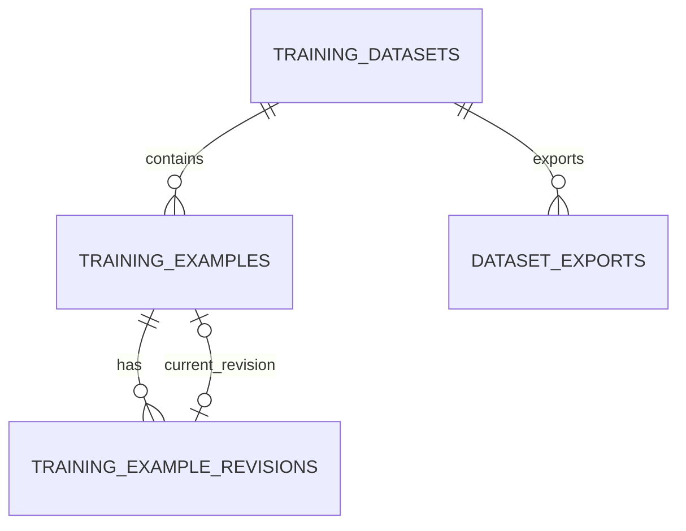

# Skema Training Dataset untuk Fine-Tuning Design Doc

| | |
|---|---|
| **Status** | Implemented |
| **Author(s)** | Muhamad Anjar |
| **Reviewer(s)** | — |
| **Tanggal Dibuat** | 2026-10-26 |
| **Terakhir Diupdate** | 2026-10-26 |
| **Service Terkait** | `aurora-rag` |
| **Ticket / Issue** | — |

## Ringkasan (TL;DR)

Aurora memerlukan skema PostgreSQL untuk mengelola `TrainingDataset` berformat ChatML, revisi contoh, validasi/review, dan export JSONL yang dapat dipakai trainer fine-tuning eksternal. Ollama bukan komponen pelatihan dalam proposal ini; hasil training eksternal dapat dimuat ke Ollama secara terpisah, dan integrasi RAG tetap tidak terhubung sampai dikonfigurasi melalui perubahan terpisah.

## Latar Belakang & Masalah

`aurora-rag` saat ini menyediakan `/ingest` dan `/query` dengan ChromaDB sebagai vector store; belum ada skema relasional atau alur pengelolaan/export dataset. `lahat_api` memiliki domain `TrainingDataset`, `TrainingExample`, `TrainingExampleRevision`, dan `DatasetExport`, termasuk validasi, review, format ChatML/Alpaca, serta export JSONL. Model dan migrasi Lahat menjadi referensi struktur, bukan pemindahan data lintas proyek.

Kebutuhan yang disepakati adalah data instruksi/percakapan untuk supervised fine-tuning, bukan pre-training korpus teks mentah. Chroma/RAG tidak menjadi sumber atau dependensi dataset saat ini. Dokumentasi Ollama yang dirujuk menjelaskan pemuatan model/adaptor, bukan pelatihan langsung dari dataset.

## Tujuan

- Menyediakan skema PostgreSQL untuk dataset ChatML dan contoh pelatihan beserta riwayat revisinya.
- Mencatat status validasi/review sehingga hanya revisi current yang valid dan approved dapat diekspor.
- Mencatat export JSONL, manifest, checksum, jumlah item, dan status hasil export.
- Memungkinkan handoff export secara manual ke trainer eksternal, di luar alur inferensi Ollama.
- Menjaga penyimpanan dataset terpisah dari Chroma dan endpoint RAG yang ada.

## Non-Tujuan (Out of Scope)

- Melatih model di dalam Ollama atau menjalankan trainer eksternal dari Aurora.
- Mengirim dataset secara otomatis ke trainer atau memuat model/adaptor hasil training ke Ollama.
- Membuat dataset otomatis dari data RAG/Chroma pada rancangan saat ini.
- Menambah dukungan format Alpaca atau korpus pre-training teks mentah.
- Multi-user dan kepemilikan dataset per pengguna; autentikasi hanya untuk satu operator lokal melalui JWT.
- Memigrasikan isi Chroma ke PostgreSQL.

## Proposal / Desain

Gunakan PostgreSQL dan empat tabel relasional yang mengikuti lifecycle Lahat dengan penyesuaian untuk penggunaan single-operator. Nama domain dipertahankan: `TrainingDataset`, `TrainingExample`, `TrainingExampleRevision`, dan `DatasetExport`. Contoh dimasukkan manual melalui API dataset; skema tidak memiliki `owner_id` atau tabel pengguna. Endpoint `/auth/token` menerima OAuth2 form dan menerbitkan JWT HS256 berumur 30 menit untuk satu operator lokal. Konfigurasi berasal dari environment: `AUTH_USERNAME`, `AUTH_PASSWORD_HASH` (bcrypt), `JWT_SECRET` minimal 32 karakter, dan `OPERATOR_UUID`; claim `sub` menjadi actor `created_by`, `reviewed_by`, dan `requested_by`. Throttling login dibatasi per process.

| Tabel | Kolom dan aturan utama |
|---|---|
| `training_datasets` | `id` UUID PK; `title` wajib; `description` opsional; `format_type` bernilai `chatml` dengan database CHECK constraint; `status` (`active`/`archived`); `version`; `created_at`, `updated_at`. Dataset archived tidak dapat diubah atau diekspor. |
| `training_examples` | `id` UUID PK; `dataset_id` FK; `current_revision_id` nullable FK ke revisi; `retired_at` nullable; `version`; `created_at`, `updated_at`. Contoh retired tidak dapat menerima revisi baru dan tidak diekspor. |
| `training_example_revisions` | `id` UUID PK; `example_id` FK; `revision_number`; `system_prompt` opsional; `content` JSONB berupa daftar pesan `user`/`assistant` bergantian yang berakhir dengan `assistant`; `schema_version`; `validation_status` (`pending`/`valid`/`invalid`); `validation_errors` JSONB; `review_status` (`pending`/`approved`/`rejected`); `reviewed_by`, `reviewed_at`, `review_note`; `created_by`; `version`; `created_at`. Constraint unik `(example_id, revision_number)`. Persetujuan hanya boleh untuk revisi valid. |
| `dataset_exports` | `id` UUID PK; `dataset_id` FK; `requested_by`; `status` (`pending`/`ready`/`failed`/`expired`); relative `object_key`; `manifest` JSONB; `checksum_sha256`; `item_count`; `error`; `created_at`, `completed_at`, `expires_at`, `expired_at`. |

Relasi `current_revision_id` membuat siklus FK dengan `training_example_revisions`; migrasi PostgreSQL harus membuat FK tersebut secara deferred/terpisah setelah tabel revisi dibuat, mengikuti pola sumber. Indeks awal: `(dataset_id, created_at, id)` pada contoh, `(example_id, created_at)` pada revisi, dan `(dataset_id, created_at)` pada export. Indeks tambahan menunggu pola query dan volume yang terukur.

Export mengambil hanya revisi current yang `validation_status = valid` dan `review_status = approved`, dari contoh active dan dataset active. Setiap baris JSONL berbentuk `{"messages":[...]}`; jika ada `system_prompt`, pesan system diletakkan pertama. JSONL ditulis streaming ke local storage di `EXPORT_ROOT` (default `./data/exports`); direktori dibatasi ke mode `0700` dan file sementara ke `0600`. File berumur 30 hari dihapus oleh cleanup periodik per 3600 detik; filesystem sweeper menghapus file JSONL kedaluwarsa tanpa bergantung pada tabel dataset. Pending export yang berumur lebih dari 24 jam hanya direkonsiliasi jika row lock tersedia; export aktif memegang lock selama streaming. Jika tabel dataset tidak tersedia, filesystem sweeper juga membersihkan file temporary berumur lebih dari 24 jam. Manifest membawa dataset ID/version, format, `export_schema_version=1`, marker serialisasi JSONL/ChatML, jumlah item, daftar revision ID, dan SHA-256. Isi record tidak ditampung seluruhnya, tetapi daftar `revision_ids` di manifest memerlukan memori sebanding jumlah record; batas volume belum diuji.

API dataset baru memerlukan Bearer JWT; `/ingest` dan `/query` tetap tidak berubah. PostgreSQL menggunakan SQLModel async dengan driver `asyncpg`, sesuai handler FastAPI yang asynchronous. Integrasi RAG tetap tidak termasuk skema saat ini.

## Alternatif yang Dipertimbangkan

| Alternatif | Kelebihan | Kekurangan | Kenapa tidak dipilih |
|---|---|---|---|
| PostgreSQL dengan empat tabel dan lifecycle revisi (dipilih) | Menjaga validasi, persetujuan, histori, dan jejak export; selaras dengan pola Lahat. | Menambah layanan database dan migrasi; perlu konfigurasi secret/credential serta operasi retensi local export. | Memenuhi kebutuhan dataset terstruktur yang dapat ditinjau sebelum dipakai trainer; SQLModel async + `asyncpg` dipilih untuk handler async. |
| Skema minimum tanpa revisi/review | Lebih sedikit tabel dan alur lebih sederhana. | Tidak menyimpan histori perubahan atau quality gate; export sulit diaudit dan contoh yang salah bisa ikut terpakai. | Lifecycle Lahat dipilih untuk menjaga kontrol kualitas dan versi. |
| Menyimpan dataset sebagai metadata Chroma / menghubungkan RAG langsung | Mengurangi komponen penyimpanan baru dan dapat memakai dokumen RAG sebagai sumber. | Relasi revision/export dan transaksi status tidak cocok dengan metadata vector; coupling RAG mengubah tujuan data. | Dataset harus terpisah dari RAG saat ini; integrasi RAG opsional dibahas kemudian. |

## Dampak & Risiko

- **Backward compatibility**: Tabel dan endpoint auth/dataset baru bersifat aditif terhadap `/ingest`, `/query`, dan collection Chroma; implementasi rute yang ada tidak berubah dan tidak ada consumer dataset lama yang harus dimigrasikan. Dataset memerlukan konfigurasi JWT; konfigurasi yang tidak valid menonaktifkan operasi dataset tanpa menggagalkan startup RAG.
- **Migrasi data**: Tidak ada migrasi konten Chroma. Downgrade menghapus tabel dan record dataset, mempertahankan enum PostgreSQL, dan tidak menghapus file export lokal. Data relasional yang dihapus tidak dapat dipulihkan tanpa backup.
- **Performa**: SQLModel async + `asyncpg` menghindari driver sinkron pada handler async. Isi JSONL diproses streaming, tetapi daftar revision ID di manifest tetap menggunakan memori O(jumlah revisi). Volume riil, batas ukuran, dan throughput belum diuji.
- **Keamanan**: Satu operator lokal menggunakan hash password bcrypt dan secret JWT dari environment; HS256 dipatok dan token berlaku 30 menit. Login dibatasi lima percobaan per 60 detik per alamat sumber yang terlihat aplikasi, dengan penyimpanan maksimum 1.024 sumber; limiter bersifat process-local dan deployment multi-worker memerlukan limiter bersama serta konfigurasi proxy/client IP tepercaya. Dataset dapat memuat kode/data internal. Upload ke Google Colab hanya setelah pemilik data memberi izin dan data layak dibagikan. Pembatasan jaringan PostgreSQL tetap tanggung jawab deployment.
- **Operasional**: PostgreSQL, SQLModel, `asyncpg`, Alembic, dan PyJWT menjadi dependency baru. Export disimpan lokal 30 hari di `EXPORT_ROOT` (default `./data/exports`); cleanup berjalan setiap 3.600 detik, merekonsiliasi export pending/failed berumur lebih dari 24 jam, dan dapat menghapus file kedaluwarsa tanpa tabel database. Metadata dipertahankan selama tabel tersedia. Backup/restore serta pemilihan trainer/framework belum ditetapkan.

## Rencana Implementasi (opsional)

1. [Selesai] Menambahkan konfigurasi environment untuk PostgreSQL dan operator, bcrypt password hash, secret JWT HS256, serta token 30 menit.
2. [Selesai] Menambahkan migration Alembic dan empat model SQLModel dengan FK current revision, indeks, state lifecycle, dan audit actor.
3. [Selesai] Menambahkan login operator, API dataset/revisi, validasi ChatML, review, dan optimistic concurrency dengan `If-Match`.
4. [Selesai] Menambahkan export JSONL streaming, manifest/checksum, file lokal dengan permission terbatas, metadata expiry, serta cleanup/reconciliation periodik.
5. [Selesai] Menjalankan test API dengan PostgreSQL, memeriksa checksum dan lifecycle export, serta memastikan `/ingest` dan `/query` tidak dimodifikasi.

## Pertanyaan Terbuka

- [perlu konfirmasi: siapa reviewer manusia yang meninjau dokumen implementasi?]
- [perlu konfirmasi: bagaimana kebijakan rotasi `JWT_SECRET`, pemulihan kredensial operator, dan penyimpanan secret pada deployment?]
- [perlu konfirmasi: berapa volume/ukuran dataset maksimum dan kebutuhan benchmark? Daftar revision ID pada manifest membuat penggunaan memori bertumbuh seiring jumlah revisi.]
- [perlu konfirmasi: trainer/framework dan format/versi ChatML untuk server sendiri atau Google Colab?]
- [perlu konfirmasi: strategi backup/restore PostgreSQL sebelum downgrade yang menghapus tabel dataset?]
- [perlu konfirmasi: bagaimana database PostgreSQL dibatasi ke jaringan lokal/tepercaya pada deployment?]
- [Asumsi implementasi: service berjalan satu process untuk limiter login; multi-worker memerlukan limiter bersama. Keputusan deployment multi-worker/TLS/proxy belum dikonfirmasi.]

## Referensi

- `../lahat_api/app/infrastructure/persistence/models.py` — model relasional dataset/revisi/export.
- `../lahat_api/migrations/versions/0001_ai_dataset_foundation.py` — constraint dan indeks schema sumber.
- `../lahat_api/app/application/datasets/service.py` — aturan validasi, review, dan pemilihan export.
- `../lahat_api/app/domain/datasets/exporting.py` — serialisasi JSONL, manifest, dan checksum.
- Ollama Modelfile: https://github.com/ollama/ollama/blob/main/docs/modelfile.md
